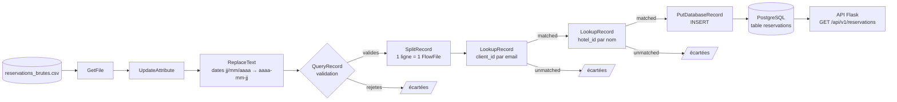
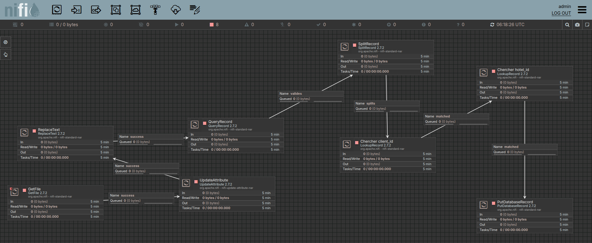

# Documentation de la partie NiFi

Document destiné au **rôle 5** (tests, documentation, présentation) et à toute personne qui doit comprendre, installer ou présenter le flux NiFi.
Il contient des éléments prêts à réutiliser : un résumé pour le README principal, un scénario de démonstration, un tableau de résultats attendus et des textes pour le PowerPoint.

Rôle 4 (NiFi) · Projet API de réservations hôtelières · Groupe 3 SIE

---

## 1. En bref (à reprendre dans le README principal et le PowerPoint)

**Apache NiFi** est un outil de gestion de flux de données (ETL : Extract, Transform, Load). On y construit, avec des blocs reliés entre eux dans une interface web, une chaîne qui lit des données, les vérifie, les transforme et les charge dans une base.

**Dans notre projet**, NiFi lit un fichier CSV de réservations brutes, corrige les dates, écarte les lignes invalides, retrouve les identifiants du client et de l'hôtel, puis insère les réservations valides dans PostgreSQL. L'API Flask expose ensuite ces réservations.

```
CSV brut  →  NiFi (nettoyage, validation, recherche des identifiants)  →  PostgreSQL  →  API Flask (REST)
```

| Information | Valeur |
|---|---|
| Version de NiFi | 2.7.2 (image Docker `apache/nifi:2.7.2`) |
| Interface web | https://localhost:8443/nifi (HTTPS, certificat auto-signé) |
| Base de données | PostgreSQL 18, base `hotel_reservation_db`, utilisateur `hotel_app` |
| Fichiers du rôle NiFi | `nifi/flow.json`, `nifi/data/reservations_brutes.csv`, `nifi/drivers/postgresql.jar`, `nifi/README.md` |

---

## 2. Schéma de l'architecture





Ce schéma s'affiche directement sur GitHub. Pour le PowerPoint, faire une capture d'écran du canvas NiFi (voir section 9).

---

## 3. Le fichier source : `nifi/data/reservations_brutes.csv`

Colonnes : `client_email, hotel_nom, hotel_ville, date_arrivee, date_depart, nb_personnes, statut`

Le fichier contient **8 lignes de données** (plus l'en-tête). Chaque ligne illustre un cas à gérer :

| # | Client | Hôtel | Arrivée → Départ | Cas illustré | Résultat |
|---|---|---|---|---|---|
| 1 | cheicki | Hotel Splendid | 2026-11-10 → 2026-11-14 | Ligne valide | **Insérée** |
| 2 | enock | Hotel Sonia | 15/11/2026 → 18/11/2026 | Dates au format `jj/mm/aaaa` | **Insérée** (dates converties en 2026-11-15 → 2026-11-18) |
| 3 | lareine | Hotel Sissiman | 2026-12-01 → 2026-12-05 | Ligne valide | **Insérée** |
| 4 | diane | Hotel Splendid | 2026-12-10 → 2026-12-08 | Départ avant l'arrivée | Rejetée par QueryRecord |
| 5 | *(vide)* | Hotel Sonia | 2026-12-12 → 2026-12-15 | Email manquant | Rejetée par QueryRecord |
| 6 | judicael | Hotel Inconnu | 2026-12-20 → 2026-12-22 | Hôtel inexistant en base | Écartée par le LookupRecord hôtel |
| 7 | cheicki | Hotel Splendid | 2026-11-10 → 2026-11-14 | Doublon exact de la ligne 1 | Refusée par la base (contrainte `uq_reservation`) |
| 8 | enock | Hotel Sonia | 2026-12-20 → 2026-12-23 | `nb_personnes` = 0 | Rejetée par QueryRecord |

**Résultat : 3 réservations insérées sur 8 lignes.**

Les emails et les noms d'hôtels du CSV correspondent aux données de `database/seed.sql`.

---

## 4. Le flux étape par étape

Le flux se trouve dans un **Process Group** nommé `reservations-hotel`. Les processors s'enchaînent dans cet ordre :

| # | Processor | Rôle | Réglages importants |
|---|---|---|---|
| 1 | **GetFile** | Lit le CSV | Dossier : `/opt/nifi/shared/data` ; filtre : `reservations_brutes\.csv` ; *Keep Source File* = `true` (le fichier n'est pas supprimé) |
| 2 | **UpdateAttribute** | Point de passage, sans transformation | Aucun réglage |
| 3 | **ReplaceText** | Normalise les dates | Regex de recherche : `(\d{2})/(\d{2})/(\d{4})` ; remplacement : `$3-$2-$1` ; mode ligne par ligne |
| 4 | **QueryRecord** | Sépare lignes valides et rejetées par deux requêtes SQL | Lecteur : `CSVReader` ; écrivain : `JsonRecordSetWriter` ; sorties `valides` et `rejetes` |
| 5 | **SplitRecord** | Une réservation par FlowFile | *Records Per Split* = `1` |
| 6 | **LookupRecord** « Chercher client_id » | Ajoute `client_id` à partir de l'email | Service `ClientLookup` (table `clients`, clé `email`, valeur `id`) ; clé de recherche `/client_email` ; résultat dans `/client_id` |
| 7 | **LookupRecord** « Chercher hotel_id » | Ajoute `hotel_id` à partir du nom de l'hôtel | Service `HotelLookup` (table `hotels`, clé `nom`, valeur `id`) ; clé de recherche `/hotel_nom` ; résultat dans `/hotel_id` |
| 8 | **PutDatabaseRecord** | Insère dans PostgreSQL | Table `public.reservations` ; *Statement Type* = `INSERT` ; champs et colonnes non concordants ignorés |

### Les requêtes SQL de QueryRecord

**`valides`** : une ligne est conservée si l'email est renseigné, les dates sont présentes, le départ est postérieur à l'arrivée, le nombre de personnes est positif et le statut est autorisé.

```sql
SELECT * FROM FLOWFILE
WHERE client_email IS NOT NULL AND client_email <> ''
  AND date_arrivee IS NOT NULL AND date_depart IS NOT NULL
  AND date_depart > date_arrivee
  AND nb_personnes > 0
  AND statut IN ('EN_ATTENTE', 'CONFIRMEE', 'ANNULEE')
```

**`rejetes`** : le contraire (les lignes invalides).

```sql
SELECT * FROM FLOWFILE
WHERE client_email IS NULL OR client_email = ''
  OR date_arrivee IS NULL OR date_depart IS NULL
  OR date_depart <= date_arrivee
  OR nb_personnes IS NULL OR nb_personnes <= 0
  OR statut NOT IN ('EN_ATTENTE', 'CONFIRMEE', 'ANNULEE')
```

### Les services de contrôleur (Controller Services)

Ce sont des composants partagés que les processors utilisent. Ils doivent tous être à l'état **Enabled**.

| Service | Rôle |
|---|---|
| `DBCPConnectionPool` | Connexion à PostgreSQL : `jdbc:postgresql://db:5432/hotel_reservation_db`, driver `org.postgresql.Driver`, fichier `/opt/nifi/nifi-current/drivers/postgresql.jar` |
| `CSVReader` | Lit le CSV (première ligne = en-tête, schéma déduit automatiquement) |
| `JsonTreeReader` | Lit les FlowFiles JSON (format de date `yyyy-MM-dd`) |
| `JsonRecordSetWriter` | Écrit les enregistrements en JSON |
| `ClientLookup` | Recherche l'`id` d'un client à partir de son `email` |
| `HotelLookup` | Recherche l'`id` d'un hôtel à partir de son `nom` |

### Gestion des erreurs et des cas particuliers

| Relation | Traitement |
|---|---|
| `rejetes` (QueryRecord) | Terminée : la ligne est abandonnée |
| `unmatched` (LookupRecord) | Terminée : client ou hôtel inconnu, la ligne est abandonnée |
| `failure` (PutDatabaseRecord) | Terminée : la ligne refusée par la base (doublon) est abandonnée |
| `original`, `failure` (autres processors) | Terminées |

---

## 5. Compteurs attendus pendant une exécution

Utile pour vérifier que le flux se comporte correctement (les nombres s'affichent dans la colonne *Queued* de chaque flèche).

| Après avoir lancé… | Ce qu'on doit voir |
|---|---|
| GetFile | 1 FlowFile de 699 octets devant UpdateAttribute |
| UpdateAttribute, puis ReplaceText | 1 FlowFile devant QueryRecord |
| QueryRecord | 1 FlowFile `valides` (945 octets) |
| SplitRecord | **5** FlowFiles (une ligne valide chacun) |
| Chercher client_id | **5** FlowFiles `matched` (les 5 emails existent) |
| Chercher hotel_id | **4** FlowFiles `matched` (« Hotel Inconnu » est écarté) |
| PutDatabaseRecord | La file se vide ; 3 réservations sont insérées, le doublon est refusé par la base |

**Base de données :** 10 réservations avant (données du `seed.sql`), **13** après.

---

## 6. Installation et lancement

### Prérequis
- Docker et Docker Compose
- Un fichier `.env` créé à partir de `.env.example`, avec un mot de passe NiFi (`NIFI_PASSWORD`) d'**au moins 12 caractères**
- Le driver `nifi/drivers/postgresql.jar` (déjà dans le dépôt)

### Lancer

```bash
cp .env.example .env        # puis modifier NIFI_PASSWORD (12 caractères minimum)
docker compose up -d db nifi
docker compose logs -f nifi # attendre « NiFi has started » (1 à 2 minutes), puis Ctrl+C
```

Ouvrir https://localhost:8443/nifi, accepter l'avertissement de certificat, puis se connecter avec `NIFI_USERNAME` et `NIFI_PASSWORD` du `.env`.

### Importer le flux
1. Glisser l'icône **Process Group** (4e icône de la barre du haut) sur le canvas.
2. Cliquer sur l'icône de téléversement à côté du champ du nom, puis choisir `nifi/flow.json`, et valider.
3. Ouvrir le groupe (clic droit, **Enter group**).
4. Clic droit sur le fond du canvas, **Controller Services**.
5. Ouvrir `DBCPConnectionPool` (engrenage), onglet **Properties**, saisir le **mot de passe de la base** (`POSTGRES_PASSWORD` du `.env`) : il n'est jamais exporté dans `flow.json`. Appliquer.
6. Activer les 6 services (⋮, **Enable**, **Service only**).

### Exécuter le flux (démonstration)

Les processors sont lancés un à un avec **Run Once** (clic droit sur le processor), dans l'ordre : GetFile, UpdateAttribute, ReplaceText, QueryRecord, SplitRecord, Chercher client_id, Chercher hotel_id, PutDatabaseRecord.
Après SplitRecord, il y a plusieurs FlowFiles : refaire **Run Once** jusqu'à vider la file, ou faire **Start**, attendre 5 secondes, puis **Stop**.

**Ne pas laisser GetFile en marche en continu** : il relirait le fichier toutes les 30 secondes (le fichier source est conservé), ce qui répéterait les tentatives d'insertion (sans créer de doublons, la base les refuse).

---

## 7. Scénario de démonstration (à reprendre dans `docs/scenario-e2e.md`)

| Étape | Action | Résultat attendu |
|---|---|---|
| 1 | Compter les réservations : `docker compose exec db psql -U hotel_app -d hotel_reservation_db -c "select count(*) from reservations;"` | `10` |
| 2 | Montrer le CSV : `cat nifi/data/reservations_brutes.csv` | 8 lignes de données, dont des cas invalides |
| 3 | Dans NiFi, lancer le flux (Run Once, dans l'ordre) | Compteurs de la section 5 |
| 4 | Compter à nouveau les réservations | `13` |
| 5 | Afficher les nouvelles lignes (requête ci-dessous) | cheicki, enock, lareine |
| 6 | Dans l'API : `GET /api/v1/reservations` | Les 3 réservations chargées apparaissent dans la liste |

Requête pour afficher les dernières réservations :

```bash
docker compose exec db psql -U hotel_app -d hotel_reservation_db -c "select r.id, c.email, h.nom, r.date_arrivee, r.date_depart, r.statut from reservations r join clients c on c.id=r.client_id join hotels h on h.id=r.hotel_id order by r.id desc limit 5;"
```

Résultat attendu :

| id | email | hôtel | arrivée | départ | statut |
|---|---|---|---|---|---|
| 13 | lareine@example.com | Hotel Sissiman | 2026-12-01 | 2026-12-05 | CONFIRMEE |
| 12 | enock@example.com | Hotel Sonia | 2026-11-15 | 2026-11-18 | EN_ATTENTE |
| 11 | cheicki@example.com | Hotel Splendid | 2026-11-10 | 2026-11-14 | CONFIRMEE |

### Rejouer la démonstration

Pour repartir de l'état initial (supprime uniquement les 3 réservations chargées par NiFi) :

```bash
docker compose exec db psql -U hotel_app -d hotel_reservation_db -c "delete from reservations where id > 10;"
```

Si on relance le flux sans nettoyer, les trois lignes sont refusées par la contrainte d'unicité : le compte reste à 13 (c'est aussi une démonstration de l'**idempotence** : relancer le flux ne crée pas de doublons).

---

## 8. Problèmes rencontrés et solutions

À mentionner dans la section « difficultés » du PowerPoint.

| Problème | Cause | Solution |
|---|---|---|
| Impossible de se connecter à NiFi | Mot de passe de moins de 12 caractères : NiFi ignore alors les identifiants du `.env` et en génère d'autres | Mot de passe de 12 caractères minimum (ou lire les identifiants générés dans les logs) |
| `Permission denied` dans le conteneur sur les dossiers partagés | SELinux (Fedora) bloque les volumes Docker | Ajouter `:z` aux volumes du `docker-compose.yml` |
| Les tables de la base n'existent pas après `docker compose up` | Même cause : SELinux empêche la lecture de `init.sql` et `seed.sql` | `:z` sur les volumes de la base (ou exécuter les scripts à la main) |
| Le service de connexion à la base échoue | Le driver PostgreSQL n'est pas dans l'image NiFi | Le télécharger dans `nifi/drivers/` et monter ce dossier en volume |
| « Driver found but not loaded » à la vérification | NiFi ne charge le driver qu'après l'enregistrement | Appliquer la configuration, puis relancer la vérification |
| Les processors ne voient pas le service de connexion | Ils avaient été créés hors du Process Group | Les déplacer dans le groupe `reservations-hotel` |
| Erreur `Key column names cannot be null or empty` | Le mode `INSERT_IGNORE` demande les colonnes de clé | Utiliser `Statement Type = INSERT` : le doublon est refusé par la contrainte `uq_reservation` |
| Un processor affiche un avertissement | Une relation de sortie n'est reliée à rien | La relier à un processor ou la terminer (*terminate*) |

---

## 9. Pour le PowerPoint

### Captures d'écran à prendre
1. Le canvas NiFi complet (les 8 processors reliés) : bien le dézoomer pour tout voir.
2. La liste des Controller Services, tous **Enabled**.
3. Le contenu du CSV de départ.
4. Le résultat de la requête SQL avant (10) et après (13).
5. Un FlowFile du lot « valides » (View content) montrant le JSON.

### Texte proposé pour une diapositive « Le flux NiFi »
- **Objectif** : alimenter la base de réservations à partir d'un fichier CSV brut
- **Extraction** : lecture du fichier `reservations_brutes.csv`
- **Transformation** : normalisation des dates, validation des champs, recherche de `client_id` et `hotel_id`
- **Chargement** : insertion dans PostgreSQL
- **Résultat** : 3 réservations valides insérées sur 8 lignes ; les lignes invalides et les doublons sont écartés

### Messages clés à retenir
- NiFi traite **chaque réservation séparément** : une ligne invalide n'empêche pas les autres d'être chargées.
- Les **doublons** sont bloqués par la base elle-même (contrainte d'unicité), donc le flux peut être rejoué sans danger.
- Le flux est **reproductible** : `flow.json` + `docker-compose.yml` + CSV + driver sont dans le dépôt.

---

## 10. Limites connues

- Les lignes rejetées ne sont **pas enregistrées** dans un fichier de rejets : leurs relations sont simplement terminées. Une amélioration possible serait de les écrire dans `nifi/data/rejets/` avec le motif du rejet.
- Le flux se lance **manuellement** (Run Once) pour la démonstration. En production, on le planifierait (planification du GetFile, ou déclenchement à l'arrivée d'un fichier).
- Le mot de passe de la base doit être **saisi après chaque import** du flux, car NiFi n'exporte jamais les valeurs sensibles.
- Les mots de passe sont ceux du fichier `.env` local : ne jamais le commiter.

---

## 11. Petit glossaire NiFi

| Terme | Signification |
|---|---|
| **Processor** | Un bloc qui effectue une action (lire un fichier, transformer, écrire en base) |
| **FlowFile** | Une unité de données qui circule dans le flux (contenu et métadonnées) |
| **Connection** | La flèche entre deux processors, qui sert aussi de file d'attente |
| **Relationship** | Une sortie d'un processor (`success`, `failure`, `matched`, `valides`…) |
| **Process Group** | Un regroupement de processors, ici `reservations-hotel` |
| **Controller Service** | Un composant partagé (connexion à la base, lecteur CSV…) |
| **Run Once** | Exécuter un processor une seule fois |
| **Terminate** | Abandonner les données d'une relation de sortie |
| **ETL** | Extract, Transform, Load : extraire, transformer, charger |
